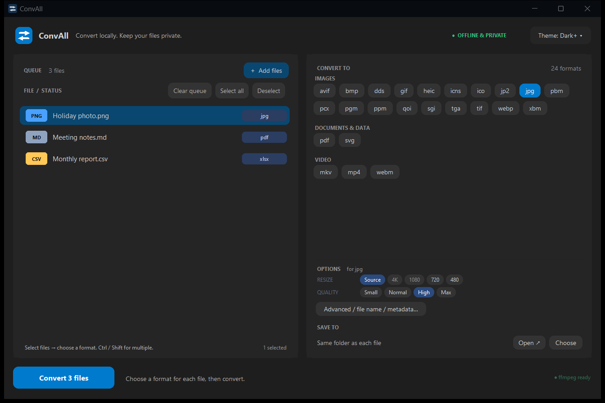
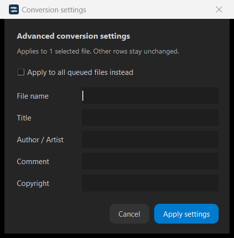
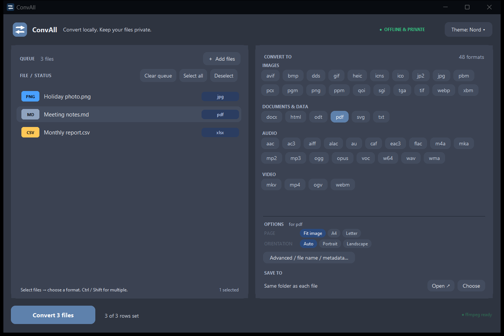

<p align="center">
  
</p>

<h1 align="center">ConvAll</h1>
<p align="center"><strong>One desktop app. Different files. Different formats.</strong><br>Convert locally. Keep your files private.</p>

<p align="center">
  <a href="https://github.com/kuy124/ConvAll/releases/latest">Download</a> ·
  <a href="#how-to-use">How to Use</a> ·
  <a href="#screenshots">Screenshots</a> ·
  <a href="#supported-conversions">Formats</a> ·
  <a href="#build-from-source">Build</a>
</p>




## About

**ConvAll** is a lightweight Windows converter for images, audio, video, PDFs,
documents, and tables. Queue different file types, choose a separate output
format for each, and convert them together—without uploading anything.

Inspired by [Convert to it!](https://p2r3.github.io/convert/), with a desktop-first
workflow and meaningful cross-media routes, such as audio → waveform → PDF.
It won't pretend to transcribe audio or recover text from a scanned document.

## Download & Run

**No Python or installer needed for the built app.** Open `ConvAll.exe`.

- **[Download the latest release](https://github.com/kuy124/ConvAll/releases/latest)**
  and open `ConvAll.exe`. Source ZIPs do not include the app.
- **Built locally:** the executable is at **`dist/ConvAll.exe`**.
- **Audio/video:** if FFmpeg is missing, click **Download FFmpeg** inside the app.
  This is a one-time network download; conversion itself stays local.

> Download the executable under **Assets**, not the source ZIP. See
> [Releases](#releases) for packaging notes.

## How to Use

1. **Add files.** Drag them into the app, click **Add files**, or double-click
   the empty **Drop files here** area.
2. **Select a row and pick a format.** Use **Ctrl / Shift-click** for multiple
   rows. Each row shows its own output format.
3. **Adjust options.** Set quality, resolution, bitrate, or PDF settings where
   available. Open **Advanced** for file names and supported metadata.
4. **Choose where to save.** Keep outputs beside their originals or choose a
   folder. **Open ↗** opens the output location.
5. **Click Convert.** Rows without an output format are left alone.

**Advanced settings belong to selected rows.** Naming one file `Faris` won't
rename the rest. Use **Apply to all queued files instead** only when you mean it.

### Useful details

| Feature | What it does |
|---|---|
| Per-file targets | Convert a photo to JPG, notes to PDF, and a table to XLSX in one batch |
| Safe output naming | Existing files get a numbered output instead of being overwritten |
| No fake upscaling | Resolution choices above a source's height are disabled; encoding also caps scaling |
| Persistent preferences | Remembers theme, output folder, last browse folder, and general conversion options |
| Themes | VS Code Dark+/Light+, Nord, Dracula, Solarized Dark/Light |
| Windows integration | Native title bar, resizing, maximize, and Snap docking |

### Keyboard shortcuts

| Shortcut | Action |
|---|---|
| `Ctrl + O` | Add files |
| `Ctrl + A` | Select all rows |
| `Delete` | Remove selected rows |
| `Enter` | Start conversion; apply changes inside Advanced |
| `Escape` | Stop after the current file / clear an idle queue; dismiss a menu or cancel Advanced |

## Screenshots

### Advanced settings — scoped to your selection

Set the output name and supported metadata without changing every file in the queue.



### Nord theme

Switch themes from the header. Your theme is remembered the next time you open the app.



## Supported Conversions

| Category | Examples |
|---|---|
| **Images** | PNG, JPG, WebP, AVIF, HEIC, GIF, TIFF, BMP, ICO, ICNS, DDS, JPEG 2000, QOI, PBM/PGM, SGI, XBM |
| **Audio** | MP3, WAV, FLAC, AAC/M4A, Opus, Ogg, AIFF, WMA, AC3/EAC3, ALAC, CAF, AU, VOC, Wave64, MKA |
| **Video** | MP4, MKV, WebM, MOV, AVI, MPEG/MPG, M4V, WMV, FLV, TS, OGV, 3GP, NUT; animated GIF/WebP |
| **PDF** | Render pages to images, extract a text layer, make PDFs from images or documents |
| **Documents** | TXT, Markdown, HTML, DOCX, ODT; text-to-speech through the Windows voice |
| **Tables** | CSV, TSV, JSON, JSONL/NDJSON, XML, XLSX, YAML |

**Cross-media examples:** video → PDF contact sheet; video → individual frames;
audio → waveform image/PDF; image → five-second video; document → speech;
table → readable document/PDF.

The engine can chain up to **three conversion steps** and cleans up intermediate
files automatically. The format picker offers reachable outputs for your selection.

### Limitations worth knowing

- DOCX/ODT conversion preserves paragraph text—not full Office layouts.
- Scanned PDFs need OCR, which is not included. A text layer is needed for text extraction.
- A waveform picture is **not** a transcript. An embedded raster SVG is **not** vector tracing.
- Available codecs depend on your FFmpeg build. Metadata support varies by format.
- Frame extraction is capped at 240 frames to avoid filling the disk.
- General quick options are batch defaults; Advanced overrides are per selected row.

## Releases

The distributable is a **single Windows executable** generated by PyInstaller.
FFmpeg stays external so users who only convert documents/images don't need the
large media toolchain.

**For maintainers:** run the checks, build the app, and attach
`dist/ConvAll.exe` to a versioned GitHub release. Include a short changelog and
the executable's SHA-256 checksum. Do not attach `build/`, caches, test outputs,
or the source-only ZIP as though it were the runnable app.

```powershell
Get-FileHash dist/ConvAll.exe -Algorithm SHA256
```

Repository description and topics: see [docs/github.md](docs/github.md).

## Build from Source

Requires **Python 3.10+ with Tkinter**. FFmpeg is needed for media checks.

```powershell
python -m pip install -r requirements-dev.txt
python tests/make_samples.py
python tests/verify.py
powershell -ExecutionPolicy Bypass -File scripts/build.ps1
```

Output: **`dist/ConvAll.exe`**. To launch without packaging:

```powershell
python src/convall.py
```

### Repository layout

```text
assets/       App icons
docs/         GitHub setup notes
screenshots/  Real app screenshots used in this README
scripts/      Build, icon generation, screenshot capture
src/          UI, engine, documents, preferences, process launcher
tests/        Conversion and interaction regression checks
```

`build/`, `dist/`, `releases/`, and generated test files are ignored.
Regenerate the screenshots with `python scripts/screenshots.py`.

## Command Line

```powershell
dist/ConvAll.exe photo.png -t pdf --page a4
dist/ConvAll.exe clip.mp4 -t mp3 --bitrate 320k -o output
dist/ConvAll.exe clip.mp4 -t png-frames --every 5
dist/ConvAll.exe notes.md -t docx
dist/ConvAll.exe --help
```

## Credits

- [Convert to it!](https://p2r3.github.io/convert/) — cross-format conversion inspiration
- [FFmpeg](https://ffmpeg.org/) — audio and video conversion
- [Pillow](https://python-pillow.org/), [PDFium](https://pdfium.googlesource.com/pdfium/),
  [pypdf](https://pypdf.readthedocs.io/) — image and PDF processing
